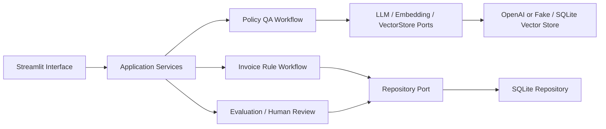

# Finance AI Copilot v0.1

> 用可追溯测试、证据门禁和 Human-in-the-loop，验证“财务制度问答 + 合成发票审核”是否值得进入小范围 Pilot 的 AI POC。

## 为什么做这个项目

财务团队经常重复回答差旅、报销和发票制度问题，也要花时间完成大量基础凭证检查。这个项目没有把目标设成“做一个看起来聪明的聊天机器人”，而是建立一套可度量的 POC：用冻结样本、失败案例、人工复核和 Pilot Gate 判断 AI 是否真正具备试点价值。

## v0.1 POC 范围

- 财务制度 Policy QA：文档导入、切分、检索、证据支持检查、引用与无依据拒答。
- 合成发票审核：字段规范化，以及日期、抬头、金额、价税、阈值、必填和重复规则。
- POC Evaluation：测试记录、失败案例、人工评审、JSON/CSV/Markdown 导出。
- Human-in-the-loop：保留 Agent 原始输出，以追加记录表达确认、覆盖或无法判断。
- Streamlit Dashboard：演示问答、规则审核、历史记录、待办队列和 Pilot Gate。

不在 v0.1 范围：真实 OCR/税务验真、自动审批、自动拒绝、自动付款、生产级权限、多租户和企业系统写入。

## 当前状态

| 项目 | 当前结果 |
|---|---:|
| pytest | 44 passed |
| 冻结 baseline | 13/13 |
| Pilot Gate | `CONDITIONAL_GO` |
| 模拟人工评审 | 8 项：confirmed 7，cannot_determine 1 |
| 越权业务动作 | 0 |
| 真实 pending review | 8 项，完整保留 |
| 历史失败 | `FAIL-POLICY-005` 保留，状态 fixed |
| Streamlit | HTTP 200 |

> **Simulated review / 模拟评审 / 非真实财务专家确认。** 模拟评审只验证流程，不计入真实财务评审覆盖率，也不是企业或专家背书。

## 核心功能

1. **证据约束 RAG**：向量相关度与引用直接支持度共同过门，城市、职级和金额等条件缺失时返回 `needs_review`。
2. **可替换 Provider**：业务模块只依赖 Port；真实 Provider 不可用、缺 Key 或调用失败时自动 fallback 到 Fake。
3. **确定性发票规则**：高确定性检查由 Python 规则完成，LLM 不负责金额计算或业务动作。
4. **失败闭环**：失败样本不会删除；修复后标记 `fixed`，继续作为永久回归测试。
5. **追加式人工复核**：HumanReviewRecord 不覆盖 Agent 原始输出；模拟评审与真实评审严格分离。
6. **Pilot Gate**：综合模块通过率、高严重度失败、真实评审覆盖和 Provider 状态输出 GO / CONDITIONAL_GO / NO_GO。

## 架构



- `core/`：公共 Schema、Port、配置、文件处理与异常。
- `modules/`：Policy QA 与 Invoice Audit 业务规则，不导入 Provider SDK。
- `adapters/`：OpenAI、Fake、SQLite 等可替换基础设施。
- `evaluation/`：baseline、指标、失败闭环、人工评审和 Pilot Gate。
- `interfaces/`：薄 Streamlit 界面，只调用 Service。
- `bootstrap/`：组合根，选择真实 Provider 或 Fake fallback。

详细说明见 [面试版架构讲解](docs/architecture-for-interview.md)。

## 技术栈

- Python 3.11+
- Pydantic v2
- Streamlit
- SQLite
- pytest
- 可选 OpenAI Python SDK（只存在于 Adapter 层）
- Port / Adapter、依赖注入、结构化评测与确定性规则

## 如何运行

### 产品 Web + FastAPI

```powershell
# 终端 1：启动版本化 API
python -m uvicorn finance_copilot.interfaces.api.app:app --reload --port 8000

# 终端 2：启动 Next.js 产品界面
cd web
Copy-Item .env.example .env.local
# 将 NEXT_PUBLIC_API_MODE 改为 http 即接入 FastAPI；保持 mock 可独立演示
npm install
npm run dev
```

Web：`http://localhost:3000`  
API 文档：`http://localhost:8000/docs`

演示角色切换不是真实鉴权，不可用于真实 Pilot。

### 外部制度与多轮对话

- “制度库”支持上传 PDF、DOCX、Markdown 和 TXT，保存版本、SHA-256、解析类型与切分数量。
- 上传文档可停用或重新启用；每次问答都会用当前有效文档替换语料索引。
- “制度问答”支持持久化会话，能将“那北京呢？”等追问补全为独立检索问题。
- 扫描 PDF 仍不执行 OCR；未提取到文本时会明确失败。

```powershell
cd "D:\AI实战项目\Finance AI Copilot"
python -m pip install -e ".[dev]"
streamlit run app.py
```

默认不需要 API Key，系统使用 Fake fallback。若后续受控启用真实 Provider，只能通过环境变量配置；不得将 Key 写入代码或提交到仓库。

## 如何测试

```powershell
python -m pytest
python scripts/run_poc_baseline.py
```

当前完整测试结果为 `44 passed`。冻结 baseline 使用 10 个制度问题和 3 个合成发票样本，结果为 13/13。

## POC 指标

- Policy QA：10/10；其中 6 个无依据问题正确路由至 `needs_review`。
- Invoice Audit：3/3；正常、异常、边界样本分别得到预期状态。
- 未关闭高严重度失败：0。
- 越权动作输出：0。
- Fake fallback：可用且已验证。
- 硬编码 API Key、真实财务数据、自动业务动作：均为 0。

完整指标见 [project-metrics.md](docs/project-metrics.md)。

## Human-in-the-loop

高风险或无依据结果进入 pending 队列。人工决定作为独立记录追加，原始 Agent 输出保持不变。Phase 13A 使用 `simulated_non_expert` 完成了 8 项流程演练，但真实 pending review 仍保留 8 项。

- [模拟评审报告](docs/simulated-human-review-report.md)
- 真实待办队列由 `data/exports/human-review/` 本地导出生成；GitHub 展示以报告中的汇总为准。

## Pilot Gate

当前结论是 `CONDITIONAL_GO`，不是 GO。自动测试和流程验证已通过，但仍缺少：

1. 真实财务专家对 8 项 pending review 的独立评审；
2. 受控真实 Provider 的质量、延迟和成本 baseline；
3. 更大规模冻结测试集与真实 Pilot 责任边界。

详见 [Pilot Gate Review](docs/pilot-gate-review.md)。

## 风险边界

- 仅使用合成样本 / 非真实数据 / 不可报销。
- 系统不自动审批、不自动拒绝、不自动付款。
- `reject` 只是 Agent 建议，最终动作必须由授权人员确认。
- 模拟评审不是财务专家意见或企业背书。
- 真实 Provider 只能经 Adapter 接入，并始终保留 Fake fallback。
