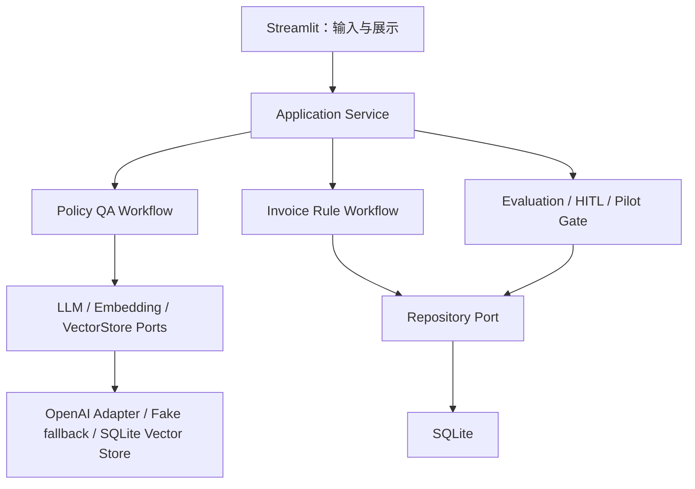

# Finance AI Copilot：面试版架构讲解

## 一句话架构

这是一个以 Service/Workflow 承载业务编排、以 Port/Adapter 隔离 Provider、以 SQLite 保存可追溯记录、以 Streamlit 做薄界面的模块化 POC。



## 为什么使用 Python

- AI、数据处理和 API SDK 生态成熟，适合快速验证 POC。
- Pydantic 能把自然语言 Agent 输出收敛为可验证 Schema。
- pytest 适合把失败案例快速转成回归测试。
- Streamlit 可以低成本展示业务闭环，让开发重点留在规则、证据和评测上。
- SQLite 与标准库足以承担 POC 持久化，避免过早引入复杂基础设施。

## 为什么使用 Port / Adapter

POC 最大的不确定性之一是 Provider：模型、Embedding、向量库和存储都可能替换。Port 定义业务需要什么能力，Adapter 负责具体实现。这样替换 OpenAI、Fake 或其他实现时，不需要重写 Policy QA 和发票规则。

这也让测试可以注入确定性 Fake，避免网络、配额和模型随机性影响回归结果。

## 为什么 Provider SDK 不进入 modules

如果业务模块直接导入 Provider SDK，模型选择、重试、超时和业务规则会耦合在一起。当前项目规定 Provider SDK 只能位于 `adapters/`：

- `modules/` 只知道 Port；
- `bootstrap/` 负责组合实现；
- 外部调用失败可统一 fallback；
- 安全扫描可以明确验证边界。

## 为什么 Streamlit 只做 Interface

Streamlit 负责表单、按钮、列表和结果展示，不负责业务判断。这样做有两个好处：

1. 同一 Service 后续可被 FastAPI、批处理或测试复用；
2. UI 改版不会改变风险规则、评测口径或审核状态。

## 为什么必须保留 Fake fallback

POC 的可运行性不能依赖某个 API Key。组合根只有在显式选择真实 Provider 且环境变量存在时才启用 OpenAI Adapter；缺 Key、SDK 构造失败或运行异常都会回退 Fake。

Fallback 不等于假装完成真实验证。运行状态和报告会明确指出当前使用 Fake，因此 Gate 仍保留真实 Provider 验证条件。

## RAG 链路如何工作

```text
Markdown/TXT/PDF
  -> 文件校验与 SHA-256
  -> 文档切分
  -> EmbeddingPort
  -> SQLite Vector Store upsert
  -> Top-k retrieve
  -> evidence support checker
  -> retrieval confidence gate
  -> LLMPort 生成回答或 needs_review fallback
  -> sources + structured AgentResponse
```

关键点是检索之后还有证据门禁。向量分数与词面支持度计算组合置信度；城市、职级和金额等关键条件必须被同一片段覆盖。证据不足时不调用 LLM，从源头避免“根据上海制度回答北京问题”。

## 发票规则引擎与 LLM 的边界

日期、抬头、金额、价税平衡、阈值、必填字段和重复检测是确定性问题，交给规则引擎。v0.1 只处理合成 JSON，不接真实 OCR。

LLM 后续最多用于解释结构化结果，不应负责金额计算、税务验真或最终审批。`pass / warning / reject / needs_review` 都是 Agent 建议，不是业务动作。

## Human-in-the-loop 如何记录

- AgentResponse 创建后保持不变。
- 人工确认、覆盖、无法判断以独立 HumanReviewRecord 追加。
- 覆盖记录保留原建议、人工决定、备注、评审人和时间。
- simulated_non_expert 与真实评审分开统计。
- 模拟评审不会清空真实 pending 队列，也不会提升真实 Gate 覆盖率。

## 从 POC 到 Pilot 如何升级

1. 由真实财务专家完成冻结样本评审并确认规则口径。
2. 在合成数据上受控启用真实 LLM/Embedding，记录质量、延迟与成本。
3. 把冻结集扩展到 20–50 个制度问题，并增加更多发票边界样本。
4. 通过 OCRPort 接入 Vision/OCR，保留低置信人工复核。
5. 用 FastAPI 复用现有 Service，增加鉴权、数据保留、审计和监控。
6. 只有 Gate 条件全部满足后，才进入有责任人的小范围 Pilot。

## 面试中建议主动强调的取舍

- 我没有追求“所有问题都有答案”，而是优先保证无依据问题可拒答。
- 我没有删除失败历史，而是把失败转成回归测试。
- 我没有把模拟评审包装成专家背书。
- 我没有因为 baseline 通过就给 GO，而是保留真实评审和 Provider 条件。
- 架构为升级留出了接口，但没有在 POC 阶段提前实现生产复杂度。

